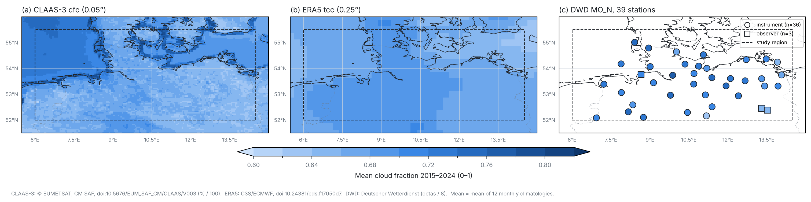

# Model error or satellite artefact? A three-way comparison of cloud cover over Northern Germany

**[AUTHOR NAME]**1

1 [Affiliation or "Independent researcher"], [City, Country] · ORCID: [0000-0000-0000-0000]

Correspondence: [e-mail]

*Manuscript v1.0, 19 November 2026*

## Key Points

- ERA5 and CLAAS-3 total cloud cover over Northern Germany differ most in summer, in both the CDR and the ICDR period
- Ceilometer stations report more cloud than both datasets in all seasons, unlike stations with human observers
- Stations report more cloud after switching from visual observation to ceilometers, which affects attribution of the bias

## Abstract

We compare monthly total cloud cover from the ERA5 reanalysis and the CM SAF CLAAS-3
satellite record over Northern Germany (52–55.5°N, 6–14.5°E) for 2015–2024, using stations
of the German Weather Service (DWD) as ground reference. All data are converted to cloud
fraction, and ERA5 and CLAAS-3 are sampled at 39 stations in the months with station
data. ERA5 and CLAAS-3 agree to within 0.01 in winter, spring and autumn, whereas in
summer (June–August) CLAAS-3 is lower than ERA5 by 0.022. Summer remains the season with
the largest difference in both the climate data record (2015–2020) and the interim
record (2021–2024). Relative to the 36 stations that measure cloud cover with
ceilometers, both datasets are lower in all seasons, by 0.03–0.05, while the three
stations with human observers agree with both datasets to within 0.03. At 11 stations
that switched from visual observation to ceilometers during the period, the station
values increased by 0.024 (about 0.2 octa) relative to ERA5 after the switch. The
seasonal pattern of the ERA5–CLAAS-3 difference is therefore insensitive to the choice
of ground reference, while its attribution to the model or to the satellite record
depends on how cloud cover is observed at the surface.

## Plain Language Summary

Cloud cover over Northern Germany can be estimated from a weather model run over past
decades (ERA5), from a geostationary weather satellite (CLAAS-3), or from ground stations
of the German Weather Service. We compared the three for 2015–2024. The model and the
satellite agree for most of the year, but in summer the satellite shows less cloud than
the model. Ground stations are normally used to decide which estimate is closer to
reality. However, the stations observe clouds in two ways: some rely on a human observer
who looks at the whole sky, others on a ceilometer, a laser instrument that detects
clouds directly overhead. Stations with ceilometers report more cloud than both the model
and the satellite, and stations that replaced the observer with a ceilometer started to
report more cloud. Which estimate is closer to reality thus depends on the type of
ground observation, while the summer difference between model and satellite is found
with both.

## 1. Introduction

Clouds strongly modulate the Earth's radiation budget (Ramanathan et al., 1989), and
cloud–climate feedbacks remain one of the least understood aspects of the climate system
(Stephens, 2005). Total cloud cover is accordingly one of the basic variables used to
evaluate weather and climate models. Two widely used long-term records are the ERA5
reanalysis (Hersbach et al., 2020) and the CM SAF Cloud property dAtAset using SEVIRI,
edition 3 (CLAAS-3; Meirink et al., 2022), which is derived from the geostationary
Meteosat satellites. In ERA5, cloud cover is a product of the forecast model,
constrained by assimilated observations; in CLAAS-3 it is obtained by classifying
satellite pixels as cloudy or clear. Differences between the two records are thus to be
expected.

Surface observations are commonly used as a reference in such comparisons. Total cloud
cover at the surface is, however, observed in two different ways: by human observers,
who estimate the fraction of the sky covered by cloud, and by ceilometers, which detect
clouds directly above the station (CM SAF, 2022b). A further complication over Northern
Germany is the viewing geometry of the geostationary satellite. The viewing zenith angle
over our study region is 60–65°, and CM SAF reports that CLAAS-3 tends to overestimate
cloud cover at such angles (CM SAF, 2022a).

In this study we address two questions: (1) in which season does ERA5 total cloud cover
deviate most from CLAAS-3 over Northern Germany, and (2) how much of that deviation can
be attributed to ERA5 and how much to the satellite record when DWD stations are used as
reference? In addition, we examine the reference itself, using stations that changed
their observing method during the study period.

## 2. Data

### 2.1 ERA5

We use ERA5 monthly averaged reanalysis of total cloud cover (`tcc`) on single levels at
0.25° resolution (Copernicus Climate Change Service, 2023). `tcc` is "the proportion of a
grid box covered by cloud", calculated "from the cloud occurring at different model
levels through the atmosphere", with "assumptions [...] about the degree of
overlap/randomness between clouds at different heights" (Copernicus Climate Change
Service, 2023). ERA5 is produced with 4D-Var data assimilation and forecasts
of one fixed version (cycle CY41R2) of the ECMWF Integrated Forecasting System (IFS), at
about 31 km horizontal resolution with 137 model levels (Hersbach et al., 2020; ECMWF,
2026). For analysed parameters such as `tcc`, the monthly means are averages of all
hourly analyses with a validity time in the month, 00–23 UTC (ECMWF, 2026). All months
used are final ERA5 (no preliminary ERA5T data).

### 2.2 CLAAS-3

CLAAS-3 cloud fractional cover (CFC) is derived from the SEVIRI imager on Meteosat
Second Generation, which scans every 15 minutes with pixels of 3 × 3 km² at the
sub-satellite point (CM SAF, 2022a). A pixel is counted as cloudy if its cloud
probability exceeds 50 %; the Level-3 CFC is "the fraction of cloudy pixels per grid box
compared to the total number of analyzed pixels in the grid box" (CM SAF, 2022a). We use
edition 3 (product version 3.0 in the file metadata) monthly means on a 0.05° grid, in
percent; daily means are based on all available 15-minute slots and the monthly mean is
the average of all daily means (CM SAF, 2022a). Data come from the climate data
record (CDR, 2015–2020) and the interim climate data record (ICDR, 2021–2024), which is
produced with the same algorithms (CM SAF, 2022b). All 120 months are present, with no
fill values and all records flagged as valid. The satellite platform attribute changes
several times during the period (Meteosat-10, -11 and, in January 2019, -9).

### 2.3 DWD stations

Station data are monthly means of total cloud cover (`MO_N`, in octas) from the DWD
Climate Data Center, retrieved with the wetterdienst package with unit conversion
switched off; the retrieved values are identical to the raw DWD files. Of 146 stations in
the study region, 76 report `MO_N` in 2015–2024. Comparing `MO_N` with the hourly cloud
cover of the same stations shows that `MO_N` is a 24-hour mean (median absolute
difference 0.007 octa, against 0.12–0.16 octa for a mean of the 06, 12 and 18 UTC
observations only).

The hourly records also indicate whether cloud cover was observed visually or measured
by an instrument. In 2015–2024, 48 stations used instruments
throughout, 12 used observers throughout, and 15 switched from observer to instrument
between 2016 and 2023.

## 3. Methods

### 3.1 Common unit

CLAAS-3 percentages are divided by 100 and DWD octas by 8; ERA5 is
already a fraction between 0 and 1.

### 3.2 Station selection

A reference series should be homogeneous in time, because a change of observing method
can introduce a non-climatic jump. We therefore exclude the 15 stations that switched
method. Since the research question concerns the seasonal cycle, we further require at
least 21 of the 30 months of every season (DJF, MAM, JJA, SON); a criterion based on the
total number of months alone would admit stations with only 16 of 30 winter or autumn
months. Of two co-located Potsdam series, the regular station is used. The remaining 39
stations comprise 36 ceilometer stations (labelled "instrument" in the figures) and 3
observer stations, which are analysed separately because the two observing methods
sample cloud cover differently. All 36 list a ceilometer (LD 40 and/or CHM 15k) in the
DWD instrument metadata for 2015–2024.

### 3.3 Matched sampling

ERA5 and CLAAS-3 are taken at the grid cell nearest to each station
(at most 14.1 km and 3.1 km away, respectively) and only in the months in which the
station reports, so that all three sources share exactly the same sampling.

### 3.4 Climatologies and statistics

For each station we form a 12-month climatology from
the available years, average these over stations and define a season as the mean of its
three months. Across stations we compute bias (dataset minus station), root-mean-square
error and Pearson correlation of the seasonal means.

### 3.5 Sensitivity to the satellite record

Results are given for 2015–2024 and, separately,
for the CDR (2015–2020) and ICDR (2021–2024) periods. To test for a change at the
CDR–ICDR transition, we remove each station's mean seasonal cycle from the differences
CLAAS-3 − station, ERA5 − station and CLAAS-3 − ERA5, average over stations, and compare
the means before and after January 2021. ERA5 has no product change at that date and
serves as a control: a shift in CLAAS-3 − station but not in ERA5 − station points to
the satellite side. Significance is assessed with an exact permutation test over all
210 ways of assigning 4 of the 10 years to the "after" group.

### 3.6 Measurement-method test

For the 15 switching stations, the switch month is the month
after the last month with at most 50 % instrument hours; months with 10–90 % instrument
hours are discarded, and stations need at least 12 months before and after the switch.
We compute the change of the deseasonalised station − ERA5 difference after the switch
and subtract the change over the same months at the 36 stable ceilometer stations
(difference-in-differences). The same is done with CLAAS-3 as reference. We report the
mean over stations with a bootstrap 95 % confidence interval and a sign test. The
selection rules and test statistics were defined before the analysis was carried out.

## 4. Results

### 4.1 Ten-year mean fields

Averaged over the study region, the 2015–2024 mean cloud fraction is 0.682 in CLAAS-3
and 0.674 in ERA5 (Fig. 1a, b). CLAAS-3 shows more spatial structure, ranging from 0.62
to 0.82, with higher values over the sea and along the coastlines than over land; ERA5
ranges only from 0.63 to 0.70. The selected stations report 0.63–0.77 (Fig. 1c). Because
the regional means include sea areas, the comparison with stations is made at the
station locations (Sections 4.2–4.3).

### 4.2 Seasonal cycle at the stations

At the 36 ceilometer stations, all three sources show the same seasonal cycle, with the
most cloud in winter (0.82 at the stations) and the least in spring and summer (0.66 and
0.64) (Fig. 2a; Table 1). ERA5 and CLAAS-3 agree closely in winter, spring and autumn
(ERA5 − CLAAS-3 between −0.006 and +0.007), but not in summer, when ERA5 exceeds CLAAS-3
by 0.022. The largest monthly differences occur in June (+0.035), August (+0.029) and
September (+0.022); in all other months the two datasets are within 0.01 of each other.

Both datasets are lower than the ceilometer stations in all twelve months (Fig. 2c):
ERA5 by 0.027–0.036 depending on the season and CLAAS-3 by 0.029–0.049, with the largest
CLAAS-3 difference in summer. At the three observer stations the monthly differences are much
smaller, between −0.039 and +0.027, and both are positive in October–December (Fig. 2b, d).

**Table 1.** Seasonal mean cloud fraction at the 36 ceilometer stations, 2015–2024, and
the ERA5 − CLAAS-3 difference in the two parts of the satellite record.

| Season | Station | ERA5 | CLAAS-3 | ERA5 − station | CLAAS-3 − station | ERA5 − CLAAS-3 | ERA5 − CLAAS-3, 2015–2020 | ERA5 − CLAAS-3, 2021–2024 |
|---|---|---|---|---|---|---|---|---|
| DJF | 0.818 | 0.783 | 0.789 | −0.035 | −0.029 | −0.006 | −0.012 | +0.004 |
| MAM | 0.659 | 0.622 | 0.622 | −0.036 | −0.037 | +0.001 | −0.001 | +0.003 |
| JJA | 0.639 | 0.611 | 0.590 | −0.027 | −0.049 | +0.022 | +0.012 | +0.035 |
| SON | 0.741 | 0.709 | 0.701 | −0.032 | −0.040 | +0.007 | −0.005 | +0.021 |

*Differences are computed from unrounded values and may differ by 0.001 from the difference of the rounded columns.*

### 4.3 Station-level agreement

Across the ceilometer stations, ERA5 reproduces the station-to-station differences in
seasonal mean cloud cover better than CLAAS-3 in every season (Fig. 3): the correlation
is 0.50–0.64 for ERA5 and 0.14–0.33 for CLAAS-3. The RMSE is 0.039–0.047 for ERA5 and
0.041–0.065 for CLAAS-3, the largest value being CLAAS-3 in summer. CLAAS-3 exceeds the
station value most at three Baltic coast or island stations (Schönhagen, Greifswalder Oie
and Boltenhagen) and falls furthest below it at inland stations (Quickborn, Schwerin and
Marnitz).

### 4.4 Sensitivity to the satellite record period

Summer is the season with the largest ERA5 − CLAAS-3 difference both in the CDR period
(+0.012) and in the ICDR period (+0.035) (Table 1). After January 2021, the deseasonalised
CLAAS-3 − station difference is lower by 0.017 (permutation p = 0.09) and CLAAS-3 − ERA5
by 0.016 (p = 0.02), while ERA5 − station does not change (−0.001, p = 0.96) (Fig. S1).
The decrease in the CLAAS-3 differences is gradual, beginning around 2020, rather than a
single step at the transition.

### 4.5 Effect of the observing method

Eleven of the 15 switching stations meet the selection rules. After the switch from
visual observation to ceilometer, the station value increases relative to ERA5 by 0.024 on average
(95 % confidence interval 0.014–0.034; 10 of 11 stations positive; sign test p = 0.012),
which corresponds to about 0.2 octa (Fig. S2b). Relative to CLAAS-3 the increase is 0.023
(0.010–0.033; 9 of 11 positive; p = 0.065). The composite aligned on the switch month
(Fig. S2a) rises gradually over several years around the switch rather than in one step,
and the set of contributing stations changes along the time axis.

## 5. Discussion

### 5.1 Seasonal difference between ERA5 and CLAAS-3

The ERA5 − CLAAS-3 difference does not involve the station data and is independent of
the observing method at the stations. It is largest in summer in both parts of the
satellite record, and in summer CLAAS-3 deviates more than ERA5 from both station types
(ceilometer stations: −0.049 versus −0.027; observer stations: −0.027 versus −0.003).
The sign of the summer difference is thus consistent across all subsets considered here,
whereas its magnitude is less certain: it increases from +0.012 to +0.035 between the two
periods, and the observer group contains only three stations. The physical cause of the
summer difference is not addressed in this study; this would require a separation by
cloud type and time of day.

### 5.2 Dependence on the observing method at the stations

Three results are consistent with each other: ceilometer stations report more cloud
than both datasets in all seasons, observer stations do not, and stations report more
cloud relative to ERA5 after switching from visual observation to ceilometers. This
suggests that a substantial part of the offset relative to the ceilometer stations is
related to the observing method rather than to errors in ERA5 or CLAAS-3; the switch
effect (0.024) is of similar magnitude to the ERA5 − station offset at the ceilometer
stations (0.027–0.036). The CM SAF validation report lists known error sources of visual
observations that act in opposite directions: observers tend to underestimate cloud
cover at night and to overestimate convective cloud viewed at slant angles in summer,
while ceilometers sample only a very small part of the sky (CM SAF, 2022b). Our data do not allow us to determine whether
observers underestimate or ceilometers overestimate cloud cover. Consequently, the
attribution of the model–satellite difference to ERA5 or CLAAS-3, our second question,
depends on the choice of reference and cannot be expressed as a single number.

### 5.3 Viewing angle

CM SAF documents an overestimation of cloud cover by CLAAS-3 at high viewing angles
(CM SAF, 2022a, 2022b), and the viewing zenith angle over Northern Germany is 60–65°.
At the land stations, however, CLAAS-3 is not higher than ERA5: the two agree outside
summer, and CLAAS-3 is lower in summer. A general overestimation relative to ERA5 is
thus not evident at land stations, although it may be present and compensated by other
effects. The higher CLAAS-3 values over the sea and at stations on the Baltic coast are
a separate feature that was not analysed here.

### 5.4 Stability of the satellite record

The gradual decrease of the CLAAS-3 differences from about 2020, with no corresponding
change in ERA5 − station, is consistent with a slow drift on the satellite side rather
than a step change at the CDR–ICDR transition. CM SAF reports a very high consistency
between the two records in their overlap year (CM SAF, 2022b) and "slight anomalies
[...] after 2018, which originate from nighttime observations" (CM SAF, 2022a). The main
result is not affected: summer has the largest ERA5 − CLAAS-3 difference in both periods.

### 5.5 Limitations

The observer group comprises only three stations, two of them in Berlin. The
method-switch test cannot distinguish a step change from a gradual trend, and the set of
contributing stations changes along the time axis. Gridded values are taken from the nearest grid cell,
whereas the stations observe either a single point or the visible sky. Finally, 21 of
the 36 ceilometer stations changed ceilometer model (LD 40 to CHM 15k) during the study
period; the effect of this change was not examined.

## 6. Conclusions

1. Over Northern Germany, ERA5 and CLAAS-3 total cloud cover differ most in summer
   (ERA5 higher by 0.022 at the stations), in both parts of the CLAAS-3 record.
2. Both datasets report less cloud than ceilometer stations in all seasons, by 0.03–0.05.
   A change of similar magnitude occurs when stations switch from visual observation to
   ceilometers, indicating that this offset is at least partly related to the observing
   method.
3. Attributing the model–satellite difference to either dataset requires a reference
   with known observing characteristics; an independent reference, such as active remote
   sensing at selected sites, would be needed.

## Open Research

ERA5 monthly averaged total cloud cover is available from the Copernicus Climate Data
Store (Copernicus Climate Change Service, 2023). CLAAS-3 cloud fractional cover is
available from the CM SAF Web User Interface (Meirink et al., 2022). DWD monthly station
observations and hourly cloudiness are available from the DWD Climate Data Center
(DWD Climate Data Center, 2024). All three are distributed under CC BY 4.0. The code,
the input and processed data used here, and the figures are available at
https://github.com/kutay-mihliardic/paper01-era5-claas3-cloud-cover (release v1.0.0)
[ZENODO DOI to be added]; `make all` reproduces all figures and tables. Station data
were retrieved with wetterdienst (version 0.185.0); figures were made with matplotlib
and cartopy.

## Acknowledgements

The work performed was done (i.a.) by using data from EUMETSAT's Satellite Application
Facility on Climate Monitoring (CM SAF); CLAAS-3 data © EUMETSAT. ERA5 data: Copernicus Climate Change Service (C3S),
ECMWF. Station data: Deutscher Wetterdienst (DWD), Climate Data Center. Coastlines:
Natural Earth.

## Supporting Information

## References

- CM SAF (2022a): Product User Manual, SEVIRI cloud products, CLAAS Edition 3,
  SAF/CM/KNMI/PUM/SEV/CLD, Issue 3.1, 8 August 2022.
- CM SAF (2022b): Validation Report, SEVIRI cloud products, CLAAS Edition 3,
  SAF/CM/KNMI/VAL/SEV/CLD, Issue 3.1, 8 August 2022.
- Copernicus Climate Change Service (2023): ERA5 monthly averaged data on single levels
  from 1940 to present. Copernicus Climate Change Service (C3S) Climate Data Store (CDS),
  doi:10.24381/cds.f17050d7 (accessed on 8 November 2026).
- DWD Climate Data Center (2024): Monthly station observations (temperature,
  precipitation, sunshine duration, wind and cloud cover) for Germany, Version v24.03.
  https://opendata.dwd.de/climate_environment/CDC/observations_germany/climate/monthly/kl/
  (accessed 8 November 2026).
- ECMWF (2026): ERA5: data documentation. Copernicus Knowledge Base,
  https://confluence.ecmwf.int/display/CKB/ERA5%3A+data+documentation (accessed 19
  November 2026).
- Hersbach, H., Bell, B., Berrisford, P., et al. (2020): The ERA5 global reanalysis.
  Q. J. R. Meteorol. Soc., 146(730), 1999–2049, doi:10.1002/qj.3803.
- Meirink, J. F., Karlsson, K.-G., Solodovnik, I., Hüser, I., Benas, N., Johansson, E.,
  Håkansson, N., Stengel, M., Selbach, N., Schröder, M., Hollmann, R. (2022): CLAAS-3: CM
  SAF CLoud property dAtAset using SEVIRI – Edition 3, Satellite Application Facility on
  Climate Monitoring, doi:10.5676/EUM_SAF_CM/CLAAS/V003.
- Ramanathan, V., Cess, R. D., Harrison, E. F., Minnis, P., Barkstrom, B. R., Ahmad, E.,
  Hartmann, D. (1989): Cloud-radiative forcing and climate: results from the Earth
  Radiation Budget Experiment. Science, 243(4887), 57–63, doi:10.1126/science.243.4887.57.
- Stephens, G. L. (2005): Cloud feedbacks in the climate system: a critical review.
  J. Climate, 18(2), 237–273, doi:10.1175/JCLI-3243.1.
